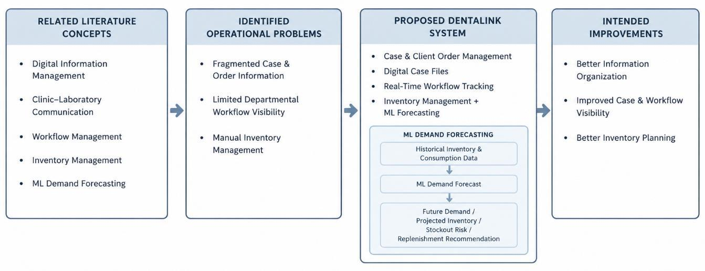
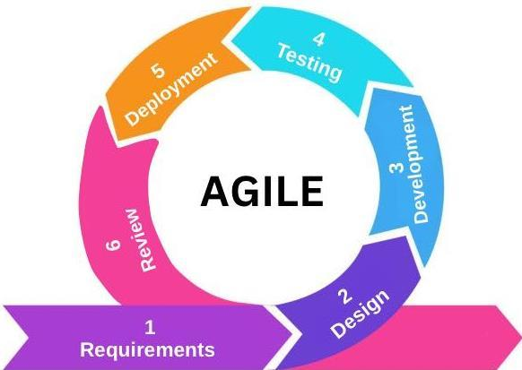
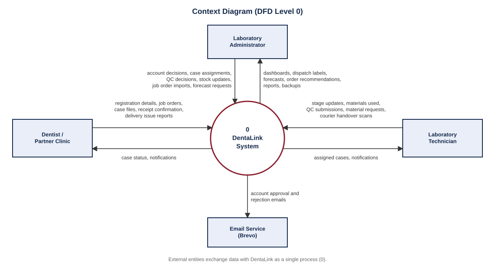
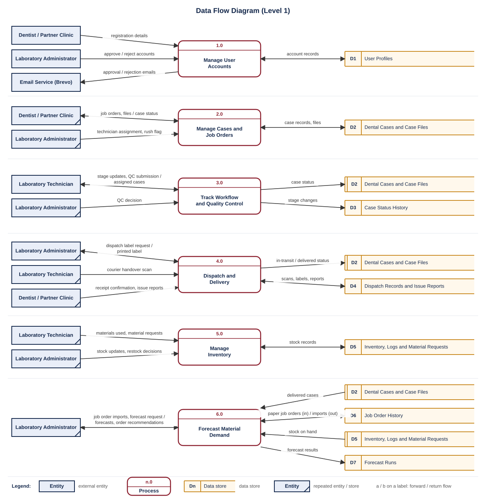
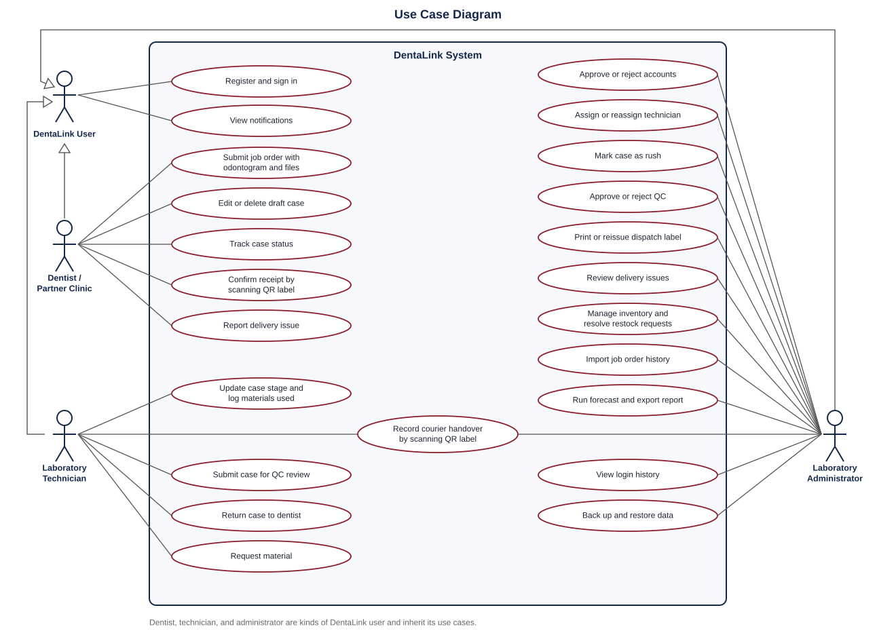
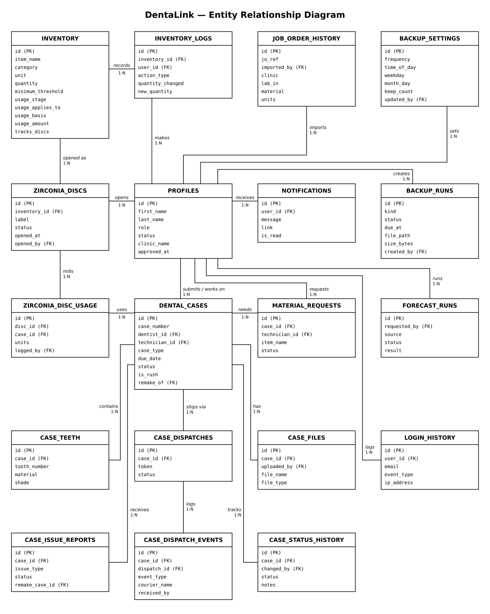
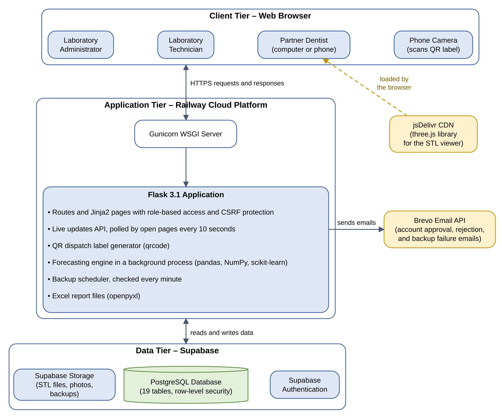
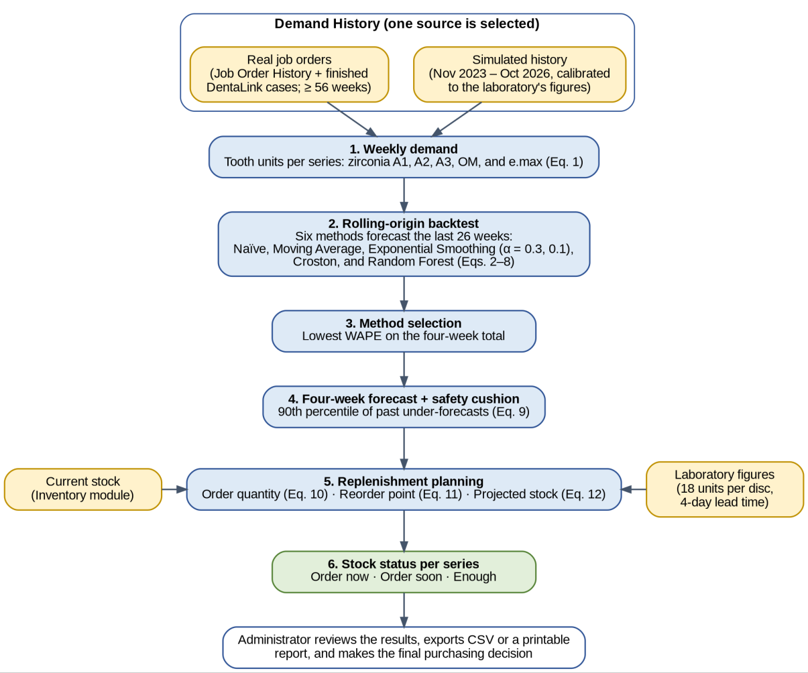

# DentaLink System Documentation

Diagrams and design notes for DentaLink: A Web-Based Laboratory Information System with Machine Learning-Based Inventory Forecasting for Mrkzter Dental Laboratory. Figures 1 to 5 are taken from the project manuscript. The data flow and use case diagrams were drawn from the system's source code (its user roles, routes, and database tables).

## Contents

1. [Conceptual framework](#1-conceptual-framework)
2. [Development methodology](#2-development-methodology)
3. [Context diagram (DFD Level 0)](#3-context-diagram-dfd-level-0)
4. [Data flow diagram (Level 1)](#4-data-flow-diagram-level-1)
5. [Use case diagram (UML)](#5-use-case-diagram-uml)
6. [Entity-relationship diagram](#6-entity-relationship-diagram)
7. [System architecture](#7-system-architecture)
8. [Forecasting process](#8-forecasting-process)
9. [Case lifecycle](#9-case-lifecycle)
10. [Database tables](#10-database-tables)

## 1. Conceptual framework



*Figure 1. Conceptual Framework of DentaLink*

## 2. Development methodology

DentaLink was developed with the Agile model over six weeks, in six phases: Requirements, Design, Development, Testing, Deployment, and Review. Each sprint produced a working, testable increment.



*Figure 2. Agile Development Phases of DentaLink*

## 3. Context diagram (DFD Level 0)

The context diagram shows DentaLink as a single process and the data it exchanges with its external entities: dentists of partner clinics, laboratory technicians, laboratory administrators, and the Brevo email service.



## 4. Data flow diagram (Level 1)

The Level 1 diagram breaks DentaLink into six processes, using Gane–Sarson notation. External entities and data stores are repeated where needed to avoid crossing lines (marked with a diagonal or an extra line).

| Process | Description | Data stores |
|---|---|---|
| 1.0 Manage User Accounts | Registration, email verification, approval or rejection by the administrator, sign-in | D1 |
| 2.0 Manage Cases and Job Orders | Dentists submit job orders and files; the administrator assigns technicians and flags rush cases | D2 |
| 3.0 Track Workflow and Quality Control | Technicians update bench stages and submit for QC; the administrator approves or rejects QC | D2, D3 |
| 4.0 Dispatch and Delivery | Dispatch labels, courier handover scans, receipt confirmation, delivery issue reports | D2, D4 |
| 5.0 Manage Inventory | Stock updates, materials used per case, material requests and restock decisions | D5 |
| 6.0 Forecast Material Demand | Imports paper job orders, forecasts demand, and recommends orders | D2, D5, D6, D7 |



## 5. Use case diagram (UML)

Dentists, technicians, and administrators are specializations of a general DentaLink user, who can register, sign in, and view notifications.



## 6. Entity-relationship diagram

The ERD shows the 19 tables of the Supabase database and their one-to-many relationships, including the zirconia disc tracking and scheduled backup tables.



*Figure 3. Entity-Relationship Diagram (ERD)*

## 7. System architecture

Users reach DentaLink through a web browser. Railway hosts the Flask application behind the Gunicorn server. The application handles requests, checks each user's role, runs the forecasting engine and the backup scheduler, and generates QR dispatch labels and Excel reports. It communicates with Supabase for the database, authentication, and file storage (including backups), and with Brevo for account and backup-failure emails.



*Figure 4. System Communication and Interaction*

## 8. Forecasting process

The forecasting engine in `ml_models/` builds weekly demand for each zirconia disc shade (A1, A2, A3, OM) and for e.max. It backtests five candidate models (naïve, 4-week moving average, simple exponential smoothing, Croston's method, and Random Forest) over the last 26 weeks with a rolling origin, keeps the most accurate model for each series, and forecasts 4 weeks ahead. The results are compared with current stock to estimate stockout risk and recommend order quantities.



*Figure 5. Forecasting Process of DentaLink*

## 9. Case lifecycle

```
draft ─► submitted ─► assigned ─► in_progress ─► cad_designing ─► wax_up_or_try_in
      ─► milling_or_printing ─► packing_and_curing ─► finishing_and_quality_check
      ─► pending_admin_review ─► ready_for_dispatch ─► in_transit ─► delivered

needs_revision : case returned to the dentist for missing information
cancelled      : case cancelled by the laboratory
```

| Stage | Who moves it | How |
|---|---|---|
| draft → submitted | Dentist | Submits the job order |
| submitted → assigned | Administrator | Assigns a technician |
| assigned → … → finishing_and_quality_check | Technician | Updates the bench stage |
| finishing_and_quality_check → pending_admin_review | Technician | Submit for QC review |
| pending_admin_review → ready_for_dispatch | Administrator | Approves QC |
| ready_for_dispatch → in_transit | Administrator / technician | Scans the QR label and records the courier |
| in_transit → delivered | Dentist | Scans the QR label and confirms receipt |

## 10. Database tables

| Table | Purpose |
|---|---|
| `profiles` | User accounts, roles, and approval status |
| `dental_cases` | Cases / job orders |
| `case_teeth` | Teeth, restoration type, material, and shade per case |
| `case_files` | Files attached to each case (stored in the `dental-case-files` bucket) |
| `case_status_history` | Every stage change, with time and user |
| `case_dispatches`, `case_dispatch_events` | QR dispatch labels and every scan |
| `case_issue_reports` | Delivery issues reported by clinics |
| `inventory`, `inventory_logs` | Stock items, material usage rules, and stock changes |
| `zirconia_discs`, `zirconia_disc_usage` | Individual opened zirconia discs and the units milled from each disc per case |
| `material_requests` | Technicians' material requests |
| `job_order_history` | Imported paper job orders |
| `forecast_runs` | Stored forecast results |
| `notifications` | In-app notifications |
| `login_history` | Sign-in activity |
| `backup_settings`, `backup_runs` | Scheduled backup settings and the record of each backup run |
