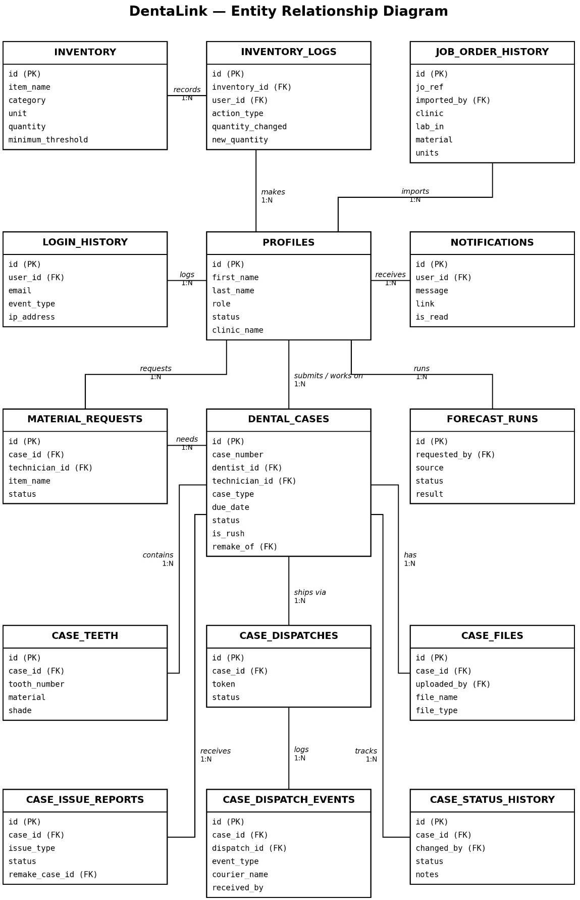
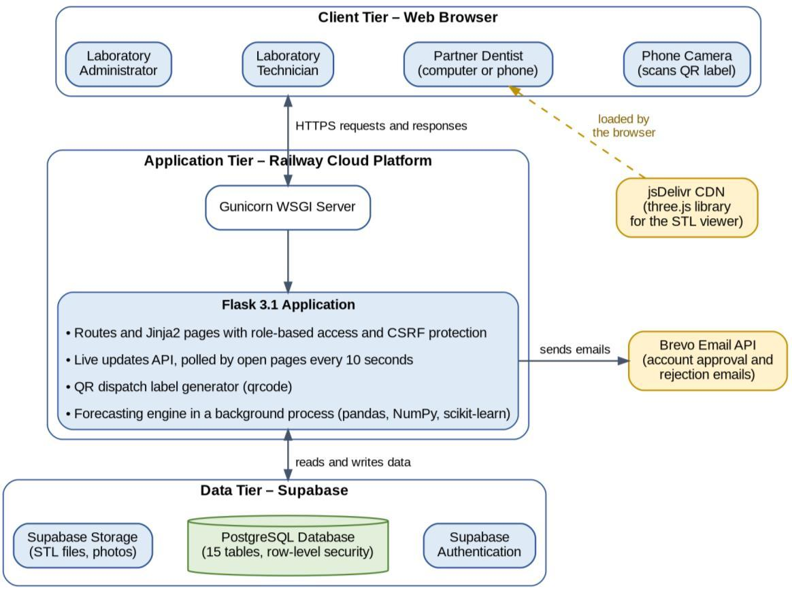

# DentaLink System Documentation

Diagrams and design notes for DentaLink: A Web-Based Laboratory Information System with Machine Learning-Based Inventory Forecasting for Mrkzter Dental Laboratory. The figures are taken from the project manuscript.

## Contents

1. [Conceptual framework](#1-conceptual-framework)
2. [Development methodology](#2-development-methodology)
3. [Entity-relationship diagram](#3-entity-relationship-diagram)
4. [System architecture](#4-system-architecture)
5. [Forecasting process](#5-forecasting-process)
6. [Case lifecycle](#6-case-lifecycle)
7. [Database tables](#7-database-tables)

## 1. Conceptual framework


*Figure 1. Conceptual Framework of DentaLink*

## 2. Development methodology

DentaLink was developed with the Agile model over six weeks, in six phases: Requirements, Design, Development, Testing, Deployment, and Review. Each sprint produced a working, testable increment.


*Figure 2. Agile Development Phases of DentaLink*

## 3. Entity-relationship diagram



*Figure 3. Entity-Relationship Diagram (ERD)*

## 4. System architecture

Users reach DentaLink through a web browser. Railway hosts the Flask application, which handles requests, checks each user's role, and communicates with Supabase for the database, authentication, and file storage, and with Brevo for email.



*Figure 4. System Communication and Interaction*

## 5. Forecasting process

The forecasting engine in `ml_models/` builds weekly demand for each zirconia disc shade (A1, A2, A3, OM) and for e.max. It backtests five candidate models (naïve, 4-week moving average, simple exponential smoothing, Croston's method, and Random Forest) over the last 26 weeks with a rolling origin, keeps the most accurate model for each series, and forecasts 4 weeks ahead. The results are compared with current stock to estimate stockout risk and recommend order quantities.


*Figure 5. Forecasting Process of DentaLink*

## 6. Case lifecycle

```
draft ─► submitted ─► assigned ─► in_progress ─► cad_designing ─► wax_up_or_try_in
      ─► milling_or_printing ─► packing_and_curing ─► finishing_and_quality_check
      ─► pending_admin_review ─► ready_for_dispatch ─► in_transit ─► delivered

needs_revision : case returned to the dentist for missing information
cancelled      : case cancelled by the laboratory
```

| Stage | Who moves it | How |
|---|---|---|
| draft → submitted | Dentist | Submits the job order |
| submitted → assigned | Administrator | Assigns a technician |
| assigned → … → finishing_and_quality_check | Technician | Updates the bench stage |
| finishing_and_quality_check → pending_admin_review | Technician | Submit for QC review |
| pending_admin_review → ready_for_dispatch | Administrator | Approves QC |
| ready_for_dispatch → in_transit | Administrator / technician | Scans the QR label and records the courier |
| in_transit → delivered | Dentist | Scans the QR label and confirms receipt |

## 7. Database tables

| Table | Purpose |
|---|---|
| `profiles` | User accounts, roles, and approval status |
| `dental_cases` | Cases / job orders |
| `case_teeth` | Teeth, restoration type, material, and shade per case |
| `case_files` | Files attached to each case (stored in the `dental-case-files` bucket) |
| `case_status_history` | Every stage change, with time and user |
| `case_dispatches`, `case_dispatch_events` | QR dispatch labels and every scan |
| `case_issue_reports` | Delivery issues reported by clinics |
| `inventory`, `inventory_logs` | Stock items and stock changes |
| `material_requests` | Technicians' material requests |
| `job_order_history` | Imported paper job orders |
| `forecast_runs` | Stored forecast results |
| `notifications` | In-app notifications |
| `login_history` | Sign-in activity |
